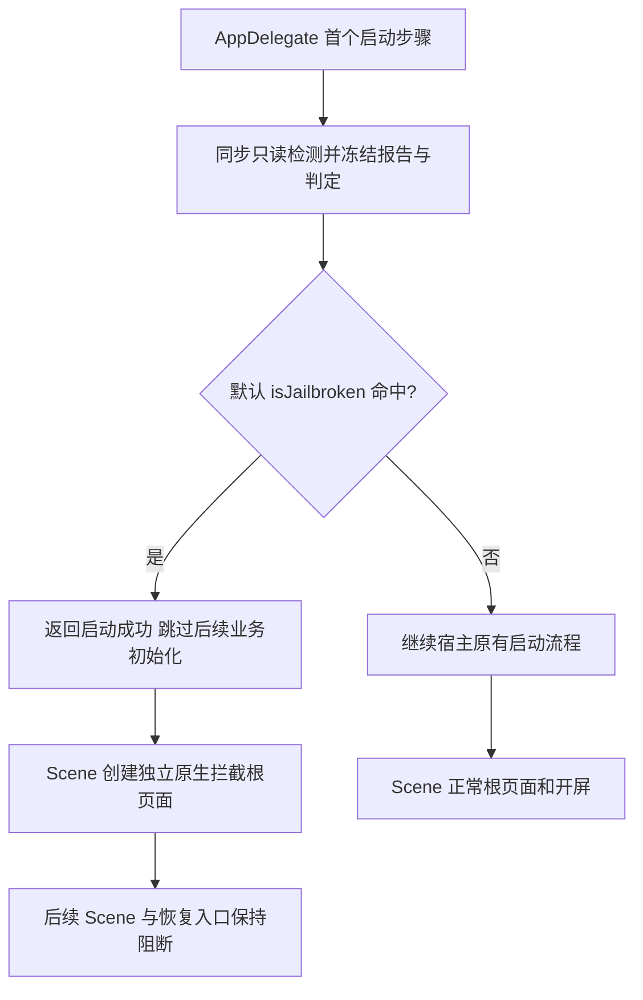

# 宿主设备安全启动门禁


<!-- jobs-toc:start -->
<!-- jobs-toc:source {"v":2,"token":"[toc]"} -->
<details>
<summary>📚 目录（点击展开 / 收起）</summary>

- [🔥 前言](#%E5%89%8D%E8%A8%80)
- [一、当前启动行为](#flow)
- [二、预留接口与调用](#interfaces)
- [三、验证与边界](#validation)

</details>
<!-- jobs-toc:end -->

---

## 🔥 <span id="前言">前言</span>

[**Objective-C**](https://developer.apple.com/library/archive/documentation/Cocoa/Conceptual/ProgrammingWithObjectiveC/Introduction/Introduction.html) 宿主在应用启动时使用已有设备检测能力，按冻结判定选择正常业务页面或全屏拦截页。检测核心与启动策略分开，未来从现有接口替换策略和页面。

返回[项目总览](../../../README.md)。

## 一、<span id="flow">当前启动行为</span> <a href="#前言" style="font-size:17px; color:green;"><b>🔼</b></a> <a href="#🔚" style="font-size:17px; color:green;"><b>🔽</b></a>

默认只在 `jailbroken` 时阻断启动；`noIndicators`、`suspicious`、`indeterminate`、`unsupported` 当前继续业务。它们不构成安全证明，当前启动策略不使用更保守的 `shouldRestrict` 建议值。检测不写系统目录，不执行安装拦截或强退。

首次判定后冻结当前进程的启动快照；每个被拦 Scene 使用新建的原生控制器，既不创建正常业务根页面，也不显示开屏或 Flutter 视图。现有生命周期、恢复和异步入口读取同一启动结果。检测核心的其它显式调用仍会实时重检，启动快照不提供持续监控或逐请求拦截。



## 二、<span id="interfaces">预留接口与调用</span> <a href="#前言" style="font-size:17px; color:green;"><b>🔼</b></a> <a href="#🔚" style="font-size:17px; color:green;"><b>🔽</b></a>

| 文件 / 接口 | 职责 |
| --- | --- |
| [JobsOCDeviceGuardLaunchGate](./JobsOCDeviceGuardLaunchGate/JobsOCDeviceGuardLaunchGate.h) | `prepare()` / `decision`、启动前 `configurePolicy:blockedViewControllerFactory:` 和 `makeBlockedViewController()`。 |
| [JobsOCDeviceGuardLaunchDecision](./JobsOCDeviceGuardLaunchDecision/JobsOCDeviceGuardLaunchDecision.h) | 不可变 `report` 与 `blocked`。 |
| [JobsOCDeviceGuardBlockedVC](./JobsOCDeviceGuardBlockedVC/JobsOCDeviceGuardBlockedVC.h) | 每个被拦 Scene 的独立原生根页面。 |

需要定制时，在 `AppDelegate` 首次评估之前配置；下面两项分别是未来策略和页面的替换点：

```objc
[JobsOCDeviceGuardLaunchGate configurePolicy:^BOOL(JobsOCDeviceGuardReport *report) {
    return report.isJailbroken;
} blockedViewControllerFactory:^UIViewController *(JobsOCDeviceGuardReport *report) {
    return [[JobsOCDeviceGuardBlockedVC alloc] initWithReport:report];
}];
if (JobsOCDeviceGuardLaunchGate.prepare().blocked) {
    return YES;
}
```

OC 新形态使用现有 `JobsOCDeviceGuard` 本地 Pod；OC 老形态仍直接编译主工程检测源码，不新增 Pod。两边宿主门禁源码保持同语义，新的实现文件参与各自主 App target。当前 OC 启动链没有 Flutter 引擎初始化路径；被拦 Scene 不创建可能承载 Flutter 的正常业务页面。

配置必须在首次判定前、主线程完成，冻结后配置返回失败。策略为同步纯判定，不能重入启动检测；页面工厂每次返回新控制器，不能触发正常业务初始化。无效或已经挂接的控制器会回退独立默认页。

默认拦截页直接继承原生 `UIViewController`，使用本地盾牌资源与语义颜色，不继承业务基类、不挂业务导航或调试面板。动态库加载、父类基础构造与系统启动画面早于该门禁，不属于可回滚的业务动作。

## 三、<span id="validation">验证与边界</span> <a href="#前言" style="font-size:17px; color:green;"><b>🔼</b></a> <a href="#🔚" style="font-size:17px; color:green;"><b>🔽</b></a>

正常启动与测试注入阻断分别验证。测试注入仅限 `DEBUG` 的隔离测试入口或编译条件，不作为 Release 环境的外部开关；测试强制阻断不证明真实越狱检出率。越狱真机、反检测环境及签名发布仍需独立验收。

2026-10-27 已通过 `byPods` 与 `main` 两端 arm64 模拟器宿主构建及正常 / 隔离注入阻断分支验证；`byPods` 侧启动门禁 [**XCTest**](https://developer.apple.com/documentation/xctest) 在正常与阻断两种启动状态各执行 5 项，均为 0 失败、0 跳过。

`main` 侧已验证正常主列表、同进程前后台往返及真实 Scene 活动恢复不能替换拦截根页面；两侧门禁源码保持一致。`byPods` 正常启动已进入既有开屏 / 系统通知授权流程，主列表后续触摸未在宿主锁屏期间继续操作。最终拦截页说明文字使用主题主文字色，浅色实拍清晰；系统外观变化遵守宿主保存的主题设置。

文档目录转换与本地链接已校验，新增 / 调整的 [**Mermaid**](https://mermaid.js.org) 流程图已本地渲染核对，远端平台渲染尚未验收。

本目录说明当前启动接入；单次检测报告 Demo 仍只展示判定。登录、支付、下单和每次网络请求没有逐项拦截器，未来须在其真实入口实时判断并完成服务端授权。

<a id="🔚" href="#前言" style="font-size:17px; color:green; font-weight:bold;">我是有底线的➤点我回到首页</a>
