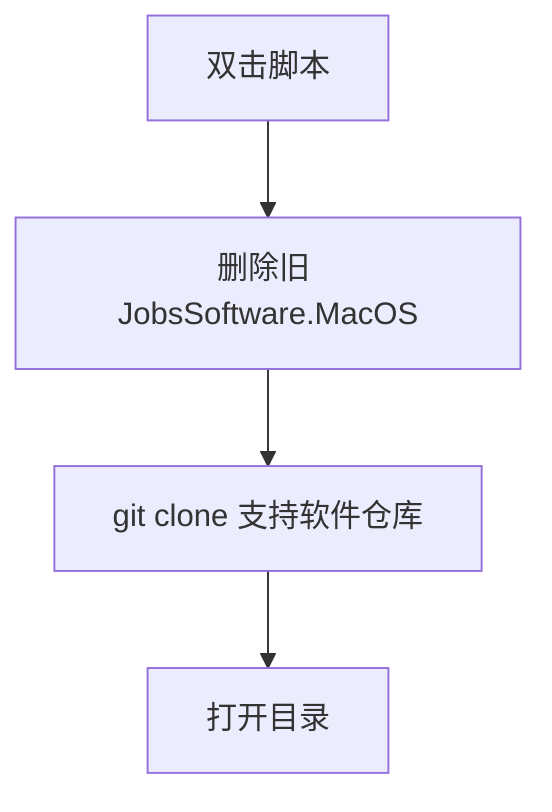

# `【MacOS】⏬双击下载Jobs支持软件.command`


<!-- jobs-toc:start -->
<!-- jobs-toc:source {"v":2,"token":"[toc]"} -->
<details>
<summary>📚 目录（点击展开 / 收起）</summary>

- [🔥 前言](#jobs-toc-heading-1)
- [一、目录结构](#jobs-toc-heading-2)
- [二、适用场景](#jobs-toc-heading-3)
- [三、运行方式](#jobs-toc-heading-4)
- [四、执行前检查](#jobs-toc-heading-5)
- [五、脚本执行流程](#jobs-toc-heading-6)
- [六、核心动作](#jobs-toc-heading-7)
- [七、日志文件](#jobs-toc-heading-8)
- [八、风险说明](#jobs-toc-heading-9)
- [九、常见问题](#jobs-toc-heading-10)
  - [1. 脚本会直接安装软件吗？](#jobs-toc-heading-11)
  - [2. 下载位置是否固定？](#jobs-toc-heading-12)
- [十、未执行声明](#jobs-toc-heading-13)

</details>
<!-- jobs-toc:end -->

---

## <span id="jobs-toc-heading-1" data-jobs-toc="v2">🔥 <font id=前言>前言</font></span><!-- jobs-toc:heading-end -->

本目录中可独立运行的 `.command` 入口先显示内置自述：标题红色加粗，编号正文蓝色且不加粗；在终端按回车确认后才进入原有流程，按 `Ctrl+C` 取消。非彩色终端显示纯文本；没有可交互输入时停止，避免确认缺失后继续执行。

`【MacOS】⏬双击下载Jobs支持软件.command` 是一个可双击运行的 macOS `.command` 脚本。

它会从 [**GitHub**](https://github.com) 的 [**JobsKits**](https://github.com/JobsKits) 拉取 `JobsSoftware.MacOS` 支持软件仓库，下载到脚本同目录下的 `JobsSoftware.MacOS`。

这份 `README.md` 用于在双击前把脚本用途、执行流程、风险点和排查方式说清楚。Jobs出品，必属精品，但危险动作也必须摊开讲明白。

## <span id="jobs-toc-heading-2" data-jobs-toc="v2">一、目录结构 <a href="#前言" style="font-size:17px; color:green;"><b>🔼</b></a> <a href="#🔚" style="font-size:17px; color:green;"><b>🔽</b></a></span><!-- jobs-toc:heading-end -->

```text
【MacOS】⏬双击下载Jobs支持软件.command/
├── 【MacOS】⏬双击下载Jobs支持软件.command
└── README.md
```

## <span id="jobs-toc-heading-3" data-jobs-toc="v2">二、适用场景 <a href="#前言" style="font-size:17px; color:green;"><b>🔼</b></a> <a href="#🔚" style="font-size:17px; color:green;"><b>🔽</b></a></span><!-- jobs-toc:heading-end -->

- 新机器需要拉取 Jobs 常用支持软件清单或资源。
- 本地 `JobsSoftware.MacOS` 目录需要覆盖更新。
- 需要下载完成后直接打开目录继续处理。

## <span id="jobs-toc-heading-4" data-jobs-toc="v2">三、运行方式 <a href="#前言" style="font-size:17px; color:green;"><b>🔼</b></a> <a href="#🔚" style="font-size:17px; color:green;"><b>🔽</b></a></span><!-- jobs-toc:heading-end -->

- 方式一：在 [**Finder**](https://support.apple.com/guide/mac-help/welcome/mac) 里双击 `【MacOS】⏬双击下载Jobs支持软件.command`。
- 方式二：在终端进入当前目录后执行：

  ```shell
  chmod +x "./【MacOS】⏬双击下载Jobs支持软件.command"
  "./【MacOS】⏬双击下载Jobs支持软件.command"
  ```


## <span id="jobs-toc-heading-5" data-jobs-toc="v2">四、执行前检查 <a href="#前言" style="font-size:17px; color:green;"><b>🔼</b></a> <a href="#🔚" style="font-size:17px; color:green;"><b>🔽</b></a></span><!-- jobs-toc:heading-end -->

- 确认已安装 `git`。
- 确认可以访问 `https://github.com/JobsKits/JobsSoftware.MacOS.git`。
- 确认同目录下已有 `JobsSoftware.MacOS` 可以删除。

## <span id="jobs-toc-heading-6" data-jobs-toc="v2">五、脚本执行流程 <a href="#前言" style="font-size:17px; color:green;"><b>🔼</b></a> <a href="#🔚" style="font-size:17px; color:green;"><b>🔽</b></a></span><!-- jobs-toc:heading-end -->



## <span id="jobs-toc-heading-7" data-jobs-toc="v2">六、核心动作 <a href="#前言" style="font-size:17px; color:green;"><b>🔼</b></a> <a href="#🔚" style="font-size:17px; color:green;"><b>🔽</b></a></span><!-- jobs-toc:heading-end -->

1. 设置支持软件仓库地址。
2. 将目标目录设置为脚本同目录下的 `JobsSoftware.MacOS`。
3. 删除旧目录。
4. 浅克隆最新仓库内容。
5. 下载完成后打开目录。

## <span id="jobs-toc-heading-8" data-jobs-toc="v2">七、日志文件 <a href="#前言" style="font-size:17px; color:green;"><b>🔼</b></a> <a href="#🔚" style="font-size:17px; color:green;"><b>🔽</b></a></span><!-- jobs-toc:heading-end -->

脚本会写入 `$TMPDIR/【MacOS】⏬双击下载Jobs支持软件.log`。

## <span id="jobs-toc-heading-9" data-jobs-toc="v2">八、风险说明 <a href="#前言" style="font-size:17px; color:green;"><b>🔼</b></a> <a href="#🔚" style="font-size:17px; color:green;"><b>🔽</b></a></span><!-- jobs-toc:heading-end -->

- 会覆盖同名目录，目录内未备份内容会被删除。
- 不会自动安装仓库里的软件，只负责下载仓库。
- 网络异常或 `git` 不存在会导致克隆失败。

## <span id="jobs-toc-heading-10" data-jobs-toc="v2">九、常见问题 <a href="#前言" style="font-size:17px; color:green;"><b>🔼</b></a> <a href="#🔚" style="font-size:17px; color:green;"><b>🔽</b></a></span><!-- jobs-toc:heading-end -->

### <span id="jobs-toc-heading-11" data-jobs-toc="v2">1. 脚本会直接安装软件吗？ <a href="#前言" style="font-size:17px; color:green;"><b>🔼</b></a> <a href="#🔚" style="font-size:17px; color:green;"><b>🔽</b></a></span><!-- jobs-toc:heading-end -->

不会。当前脚本只克隆仓库并打开目录。

### <span id="jobs-toc-heading-12" data-jobs-toc="v2">2. 下载位置是否固定？ <a href="#前言" style="font-size:17px; color:green;"><b>🔼</b></a> <a href="#🔚" style="font-size:17px; color:green;"><b>🔽</b></a></span><!-- jobs-toc:heading-end -->

固定在脚本同目录下的 `JobsSoftware.MacOS`。
## <span id="jobs-toc-heading-13" data-jobs-toc="v2">十、未执行声明 <a href="#前言" style="font-size:17px; color:green;"><b>🔼</b></a> <a href="#🔚" style="font-size:17px; color:green;"><b>🔽</b></a></span><!-- jobs-toc:heading-end -->

- 本次整理只读取脚本源码并生成 `README.md`，没有在 macOS 真机环境执行脚本。
- 当前打包环境不提供 macOS 专属工具链，未执行 `【MacOS】⏬双击下载Jobs支持软件.command` 的真实安装、下载、构建或系统修改动作。
- 脚本源码保持原样，仅新增同目录 `README.md` 并按同名文件夹重新打包。

<a id="🔚" href="#前言" style="font-size:17px; color:green; font-weight:bold;">我是有底线的➤点我回到首页</a>
