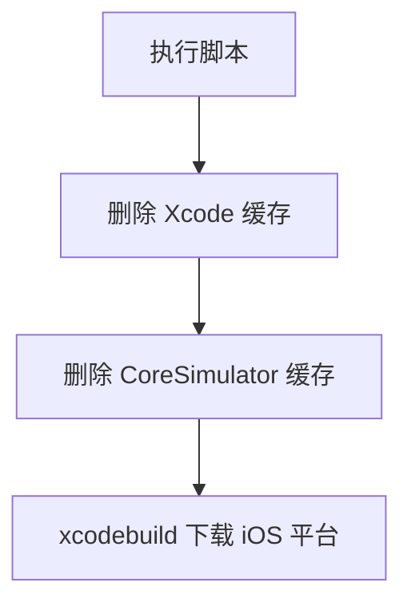

# `【MacOS】⏬命令行下载Xcode模拟器配件.command`


<!-- jobs-toc:start -->
<!-- jobs-toc:source {"v":2,"token":"[toc]"} -->
<details>
<summary>📚 目录（点击展开 / 收起）</summary>

- [🔥 前言](#jobs-toc-heading-1)
- [一、目录结构](#jobs-toc-heading-2)
- [二、适用场景](#jobs-toc-heading-3)
- [三、运行方式](#jobs-toc-heading-4)
- [四、执行前检查](#jobs-toc-heading-5)
- [五、脚本执行流程](#jobs-toc-heading-6)
- [六、核心动作](#jobs-toc-heading-7)
- [七、日志文件](#jobs-toc-heading-8)
- [八、风险说明](#jobs-toc-heading-9)
- [九、常见问题](#jobs-toc-heading-10)
  - [1. 提示 xcodebuild 找不到怎么办？](#jobs-toc-heading-11)
  - [2. 清理缓存会删项目吗？](#jobs-toc-heading-12)
- [十、未执行声明](#jobs-toc-heading-13)

</details>
<!-- jobs-toc:end -->

---

## <span id="jobs-toc-heading-1" data-jobs-toc="v2">🔥 <font id=前言>前言</font></span><!-- jobs-toc:heading-end -->

本目录中可独立运行的 `.command` 入口先显示内置自述：标题红色加粗，编号正文蓝色且不加粗；在终端按回车确认后才进入原有流程，按 `Ctrl+C` 取消。非彩色终端显示纯文本；没有可交互输入时停止，避免确认缺失后继续执行。

`【MacOS】⏬命令行下载Xcode模拟器配件.command` 是一个可双击运行的 macOS `.command` 脚本。

它会清理部分 [**Xcode**](https://developer.apple.com/xcode) 缓存，然后通过 `xcodebuild -downloadPlatform iOS -verbose` 下载 iOS 模拟器平台配件。

这份 `README.md` 用于在双击前把脚本用途、执行流程、风险点和排查方式说清楚。Jobs出品，必属精品，但危险动作也必须摊开讲明白。

## <span id="jobs-toc-heading-2" data-jobs-toc="v2">一、目录结构 <a href="#前言" style="font-size:17px; color:green;"><b>🔼</b></a> <a href="#🔚" style="font-size:17px; color:green;"><b>🔽</b></a></span><!-- jobs-toc:heading-end -->

```text
【MacOS】⏬命令行下载Xcode模拟器配件.command/
├── 【MacOS】⏬命令行下载Xcode模拟器配件.command
└── README.md
```

## <span id="jobs-toc-heading-3" data-jobs-toc="v2">二、适用场景 <a href="#前言" style="font-size:17px; color:green;"><b>🔼</b></a> <a href="#🔚" style="font-size:17px; color:green;"><b>🔽</b></a></span><!-- jobs-toc:heading-end -->

- Xcode 下载 iOS 模拟器平台失败，需要清理缓存后重试。
- 新装或升级 Xcode 后，需要命令行补齐 iOS 模拟器平台。
- 希望通过终端看到 verbose 下载过程。

## <span id="jobs-toc-heading-4" data-jobs-toc="v2">三、运行方式 <a href="#前言" style="font-size:17px; color:green;"><b>🔼</b></a> <a href="#🔚" style="font-size:17px; color:green;"><b>🔽</b></a></span><!-- jobs-toc:heading-end -->

- 方式一：在 [**Finder**](https://support.apple.com/guide/mac-help/welcome/mac) 里双击 `【MacOS】⏬命令行下载Xcode模拟器配件.command`。
- 方式二：在终端进入当前目录后执行：

  ```shell
  chmod +x "./【MacOS】⏬命令行下载Xcode模拟器配件.command"
  "./【MacOS】⏬命令行下载Xcode模拟器配件.command"
  ```


## <span id="jobs-toc-heading-5" data-jobs-toc="v2">四、执行前检查 <a href="#前言" style="font-size:17px; color:green;"><b>🔼</b></a> <a href="#🔚" style="font-size:17px; color:green;"><b>🔽</b></a></span><!-- jobs-toc:heading-end -->

- 确认已安装完整 Xcode，不只是 Command Line Tools。
- 确认 `xcode-select -p` 指向正确 Xcode。
- 确认网络可访问 Apple 开发者下载服务。
- 确认可以删除 `~/Library/Caches/com.apple.dt.Xcode` 和 `~/Library/Developer/CoreSimulator/Caches`。

## <span id="jobs-toc-heading-6" data-jobs-toc="v2">五、脚本执行流程 <a href="#前言" style="font-size:17px; color:green;"><b>🔼</b></a> <a href="#🔚" style="font-size:17px; color:green;"><b>🔽</b></a></span><!-- jobs-toc:heading-end -->



## <span id="jobs-toc-heading-7" data-jobs-toc="v2">六、核心动作 <a href="#前言" style="font-size:17px; color:green;"><b>🔼</b></a> <a href="#🔚" style="font-size:17px; color:green;"><b>🔽</b></a></span><!-- jobs-toc:heading-end -->

1. 开启 `set -euo pipefail`。
2. 删除 Xcode 下载缓存目录。
3. 删除 CoreSimulator 缓存目录。
4. 执行 `xcodebuild -downloadPlatform iOS -verbose`。

## <span id="jobs-toc-heading-8" data-jobs-toc="v2">七、日志文件 <a href="#前言" style="font-size:17px; color:green;"><b>🔼</b></a> <a href="#🔚" style="font-size:17px; color:green;"><b>🔽</b></a></span><!-- jobs-toc:heading-end -->

当前脚本没有定义 `LOG_FILE`，不会主动写入 `$TMPDIR/脚本名.log`；请保留终端输出用于排查。

## <span id="jobs-toc-heading-9" data-jobs-toc="v2">八、风险说明 <a href="#前言" style="font-size:17px; color:green;"><b>🔼</b></a> <a href="#🔚" style="font-size:17px; color:green;"><b>🔽</b></a></span><!-- jobs-toc:heading-end -->

- 会删除当前用户下的 Xcode / CoreSimulator 缓存，缓存会在后续使用中重建。
- 双击后先阅读内置自述，按回车确认才执行；按 `Ctrl+C` 取消。
- 下载体积可能较大，受 Xcode 版本、网络和 Apple 服务状态影响。
- 脚本没有独立日志文件，终端输出是主要排查依据。

## <span id="jobs-toc-heading-10" data-jobs-toc="v2">九、常见问题 <a href="#前言" style="font-size:17px; color:green;"><b>🔼</b></a> <a href="#🔚" style="font-size:17px; color:green;"><b>🔽</b></a></span><!-- jobs-toc:heading-end -->

### <span id="jobs-toc-heading-11" data-jobs-toc="v2">1. 提示 xcodebuild 找不到怎么办？ <a href="#前言" style="font-size:17px; color:green;"><b>🔼</b></a> <a href="#🔚" style="font-size:17px; color:green;"><b>🔽</b></a></span><!-- jobs-toc:heading-end -->

先安装完整 Xcode，并确认 `xcode-select -p` 指向 `$APPLICATIONS_DIR/Xcode.app/Contents/Developer`。

### <span id="jobs-toc-heading-12" data-jobs-toc="v2">2. 清理缓存会删项目吗？ <a href="#前言" style="font-size:17px; color:green;"><b>🔼</b></a> <a href="#🔚" style="font-size:17px; color:green;"><b>🔽</b></a></span><!-- jobs-toc:heading-end -->

不会直接删除你的工程源码，但会清理 Xcode 和模拟器缓存。
## <span id="jobs-toc-heading-13" data-jobs-toc="v2">十、未执行声明 <a href="#前言" style="font-size:17px; color:green;"><b>🔼</b></a> <a href="#🔚" style="font-size:17px; color:green;"><b>🔽</b></a></span><!-- jobs-toc:heading-end -->

- 本次整理只读取脚本源码并生成 `README.md`，没有在 macOS 真机环境执行脚本。
- 当前打包环境不提供 macOS 专属工具链，未执行 `【MacOS】⏬命令行下载Xcode模拟器配件.command` 的真实安装、下载、构建或系统修改动作。
- 脚本源码保持原样，仅新增同目录 `README.md` 并按同名文件夹重新打包。

<a id="🔚" href="#前言" style="font-size:17px; color:green; font-weight:bold;">我是有底线的➤点我回到首页</a>
