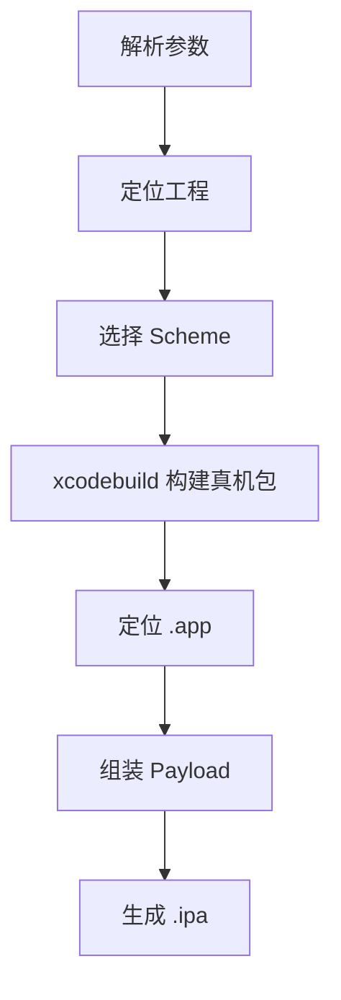

# `【MacOS】📦双击自动生成ipa文件.command`


<!-- jobs-toc:start -->
<!-- jobs-toc:source {"v":2,"token":"[toc]"} -->
<details>
<summary>📚 目录（点击展开 / 收起）</summary>

- [🔥 前言](#jobs-toc-heading-1)
- [一、目录结构](#jobs-toc-heading-2)
- [二、适用场景](#jobs-toc-heading-3)
- [三、运行方式](#jobs-toc-heading-4)
- [四、执行前检查](#jobs-toc-heading-5)
- [五、脚本执行流程](#jobs-toc-heading-6)
- [六、核心动作](#jobs-toc-heading-7)
- [七、日志文件](#jobs-toc-heading-8)
- [八、风险说明](#jobs-toc-heading-9)
- [九、常见问题](#jobs-toc-heading-10)
  - [1. 如何指定工程？](#jobs-toc-heading-11)
  - [2. 如何指定输出目录？](#jobs-toc-heading-12)
  - [3. 构建失败怎么查？](#jobs-toc-heading-13)
- [十、未执行声明](#jobs-toc-heading-14)

</details>
<!-- jobs-toc:end -->

---

## <span id="jobs-toc-heading-1" data-jobs-toc="v2">🔥 <font id=前言>前言</font></span><!-- jobs-toc:heading-end -->

`【MacOS】📦双击自动生成ipa文件.command` 是一个可双击运行的 macOS `.command` 脚本。

它是 iOS IPA 打包助手，会自动定位主 [**Xcode**](https://developer.apple.com/xcode) 工程、选择 Scheme、执行真机 `xcodebuild` 构建，并把生成的 `.app` 组装成 `.ipa` 输出到桌面或指定目录。

这份 `README.md` 用于在双击前把脚本用途、执行流程、风险点和排查方式说清楚。Jobs出品，必属精品，但危险动作也必须摊开讲明白。

## <span id="jobs-toc-heading-2" data-jobs-toc="v2">一、目录结构 <a href="#前言" style="font-size:17px; color:green;"><b>🔼</b></a> <a href="#🔚" style="font-size:17px; color:green;"><b>🔽</b></a></span><!-- jobs-toc:heading-end -->

```text
【MacOS】📦双击自动生成ipa文件.command/
├── 【MacOS】📦双击自动生成ipa文件.command
└── README.md
```

## <span id="jobs-toc-heading-3" data-jobs-toc="v2">二、适用场景 <a href="#前言" style="font-size:17px; color:green;"><b>🔼</b></a> <a href="#🔚" style="font-size:17px; color:green;"><b>🔽</b></a></span><!-- jobs-toc:heading-end -->

- iOS 原生工程需要快速生成 `.ipa`。
- 项目有多个 Scheme，需要自动筛选主 Scheme 或用 `fzf` 选择。
- 需要避开 Flutter Runner 壳工程，定位真实主工程。
- 希望失败时自动打开日志。

## <span id="jobs-toc-heading-4" data-jobs-toc="v2">三、运行方式 <a href="#前言" style="font-size:17px; color:green;"><b>🔼</b></a> <a href="#🔚" style="font-size:17px; color:green;"><b>🔽</b></a></span><!-- jobs-toc:heading-end -->

- 方式一：在 [**Finder**](https://support.apple.com/guide/mac-help/welcome/mac) 里双击 `【MacOS】📦双击自动生成ipa文件.command`。
- 方式二：在终端进入当前目录后执行：

  ```shell
  chmod +x "./【MacOS】📦双击自动生成ipa文件.command"
  "./【MacOS】📦双击自动生成ipa文件.command"
  ```

- 常用参数示例：

  ```shell
  "./【MacOS】📦双击自动生成ipa文件.command" --config Release --out "$HOME/Desktop"
  "./【MacOS】📦双击自动生成ipa文件.command" --project "./MyApp.xcworkspace" --scheme "MyApp" --confirm
  "./【MacOS】📦双击自动生成ipa文件.command" --allow-updates
  ```


## <span id="jobs-toc-heading-5" data-jobs-toc="v2">四、执行前检查 <a href="#前言" style="font-size:17px; color:green;"><b>🔼</b></a> <a href="#🔚" style="font-size:17px; color:green;"><b>🔽</b></a></span><!-- jobs-toc:heading-end -->

- 确认已安装完整 Xcode，并且签名、证书、描述文件可用于真机构建。
- 确认工程的 Scheme 是 shared，否则 `xcodebuild -list` 可能列不出来。
- 如果有多个 Scheme，建议安装 `fzf` 方便选择；未安装时脚本会自动兜底。
- 确认默认输出目录 `$HOME/Desktop` 或 `--out` 指定目录可写。

## <span id="jobs-toc-heading-6" data-jobs-toc="v2">五、脚本执行流程 <a href="#前言" style="font-size:17px; color:green;"><b>🔼</b></a> <a href="#🔚" style="font-size:17px; color:green;"><b>🔽</b></a></span><!-- jobs-toc:heading-end -->



## <span id="jobs-toc-heading-7" data-jobs-toc="v2">六、核心动作 <a href="#前言" style="font-size:17px; color:green;"><b>🔼</b></a> <a href="#🔚" style="font-size:17px; color:green;"><b>🔽</b></a></span><!-- jobs-toc:heading-end -->

1. 解析命令行参数。
2. 定位脚本目录和主工程 `.xcodeproj` / `.xcworkspace`。
3. 读取 `xcodebuild -list` 输出并筛选 Scheme。
4. 优先自动选择与工程同名的主 Scheme，必要时用 `fzf` 选择。
5. 通过 `xcodebuild -showBuildSettings` 定位 `.app` 输出路径。
6. 使用 `xcodebuild ... -destination generic/platform=iOS build` 构建。
7. 在临时目录创建 `Payload` 并复制 `.app`。
8. 使用 `$SYSTEM_USR_DIR/bin/zip` 生成 `.ipa`。
9. 打开输出目录。

## <span id="jobs-toc-heading-8" data-jobs-toc="v2">七、日志文件 <a href="#前言" style="font-size:17px; color:green;"><b>🔼</b></a> <a href="#🔚" style="font-size:17px; color:green;"><b>🔽</b></a></span><!-- jobs-toc:heading-end -->

脚本会写入 `$TMPDIR/【MacOS】📦双击自动生成ipa文件.command.log`。注意这里的日志名保留了 `.command` 后缀。

## <span id="jobs-toc-heading-9" data-jobs-toc="v2">八、风险说明 <a href="#前言" style="font-size:17px; color:green;"><b>🔼</b></a> <a href="#🔚" style="font-size:17px; color:green;"><b>🔽</b></a></span><!-- jobs-toc:heading-end -->

- 会删除并重建 `$HOME/Library/Developer/Xcode/DerivedData/JobsIpaBuild`。
- 执行 `xcodebuild` 会触发真实编译、签名和依赖构建。
- `--allow-updates` 会传入 `-allowProvisioningUpdates`，可能影响签名配置，默认关闭。
- 脚本不执行 App Store 导出流程，只把 `.app` 打包成 `.ipa`。

## <span id="jobs-toc-heading-10" data-jobs-toc="v2">九、常见问题 <a href="#前言" style="font-size:17px; color:green;"><b>🔼</b></a> <a href="#🔚" style="font-size:17px; color:green;"><b>🔽</b></a></span><!-- jobs-toc:heading-end -->

### <span id="jobs-toc-heading-11" data-jobs-toc="v2">1. 如何指定工程？ <a href="#前言" style="font-size:17px; color:green;"><b>🔼</b></a> <a href="#🔚" style="font-size:17px; color:green;"><b>🔽</b></a></span><!-- jobs-toc:heading-end -->

使用 `--project ./MyApp.xcworkspace` 或 `--project ./MyApp.xcodeproj`。

### <span id="jobs-toc-heading-12" data-jobs-toc="v2">2. 如何指定输出目录？ <a href="#前言" style="font-size:17px; color:green;"><b>🔼</b></a> <a href="#🔚" style="font-size:17px; color:green;"><b>🔽</b></a></span><!-- jobs-toc:heading-end -->

使用 `--out ~/Desktop/ipa`。

### <span id="jobs-toc-heading-13" data-jobs-toc="v2">3. 构建失败怎么查？ <a href="#前言" style="font-size:17px; color:green;"><b>🔼</b></a> <a href="#🔚" style="font-size:17px; color:green;"><b>🔽</b></a></span><!-- jobs-toc:heading-end -->

脚本会打开 `$TMPDIR/【MacOS】📦双击自动生成ipa文件.command.log`，先看里面的 `xcodebuild` 错误。
## <span id="jobs-toc-heading-14" data-jobs-toc="v2">十、未执行声明 <a href="#前言" style="font-size:17px; color:green;"><b>🔼</b></a> <a href="#🔚" style="font-size:17px; color:green;"><b>🔽</b></a></span><!-- jobs-toc:heading-end -->

- 本次整理只读取脚本源码并生成 `README.md`，没有在 macOS 真机环境执行脚本。
- 当前打包环境不提供 macOS 专属工具链，未执行 `【MacOS】📦双击自动生成ipa文件.command` 的真实安装、下载、构建或系统修改动作。
- 脚本源码保持原样，仅新增同目录 `README.md` 并按同名文件夹重新打包。

<a id="🔚" href="#前言" style="font-size:17px; color:green; font-weight:bold;">我是有底线的➤点我回到首页</a>
