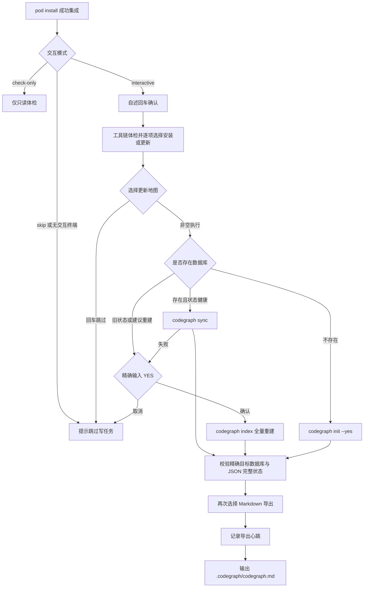

# `codegraph_init.command`


<!-- jobs-toc:start -->
<!-- jobs-toc:source {"v":2,"token":"[toc]"} -->
<details>
<summary>📚 目录（点击展开 / 收起）</summary>

- [🔥 前言](#jobs-toc-heading-1)
- [一、执行流程](#jobs-toc-heading-2)
- [二、运行方式](#jobs-toc-heading-3)
- [三、等待与心跳](#jobs-toc-heading-4)
- [四、导出参数](#jobs-toc-heading-5)
- [五、日志文件](#jobs-toc-heading-6)
- [六、环境开关与恢复边界](#jobs-toc-heading-7)

</details>
<!-- jobs-toc:end -->

---

## <span id="jobs-toc-heading-1" data-jobs-toc="v2">🔥 <font id=前言>前言</font></span><!-- jobs-toc:heading-end -->

入口先显示内置自述：标题红色加粗，编号正文蓝色且不加粗；终端按回车后进入工具链体检，各项安装、更新、地图同步和报告导出均为“直接回车跳过、任意非空输入执行”，按 `Ctrl+C` 取消。全量重建数据库另需精确输入 `YES`。没有可交互输入时，默认清楚提示并跳过写任务，不创建日志或锁；显式 `--check-only` / `JOBS_POD_INSTALL_INTERACTION=check-only` 只读体检，不安装、建图或导出，不能据此声称地图已更新。`CODEGRAPH_AUTO_INIT`、`JOBS_POD_INSTALL_HOOK` 和旧确认环境变量都不能跳过终端确认。

`codegraph_init.command` 由 `Podfile` 的 `post_integrate` 在工程集成完成后同步调用，在当前终端选择 [**CodeGraph**](https://github.com/colbymchenry/codegraph) 初始化 / 同步及相邻 `../codegraph_export_md.command/codegraph_export_md.command` 的深度 [**Markdown**](https://markdown.cn) / [**Mermaid**](https://mermaid.js.org) 图谱导出。

自动流程包含：

- `pod install` 成功集成后保留终端输入，等待用户选择和本次任务完成；辅助脚本失败只告警，不改变 CocoaPods 已完成的安装结果。
- 导出慢时定时记录心跳和最近日志，便于判断任务是否仍在运行。
- 默认不再硬筛 `calls,extends,implements`，而是交给导出脚本根据数据库实际 `edge kind` 自动生成有内容的报告。
- 工具按“发现 → 实际执行体检 → 逐项选择安装 / 更新 → 执行一次 → 复检”处理；健康组件默认复用，普通操作回车跳过。
- 全局工具链锁串行化体检与安装，工程锁覆盖索引及导出；重复调用不会并发改写同一工程。
- 成功必须同时满足精确工程数据库的 `nodes` 表、JSON 项目 / 输出路径、索引时间、完整状态及待处理计数校验。

| 检查对象 | 当前行为 |
| --- | --- |
| 工具链 | 系统工具、CLT、Homebrew、Node/npm、CodeGraph 和 SQLite / JSON 逐层实际执行检查；交互流程使用隔离样例真实建图 |
| 安装 / 更新选择 | 允许安装且用户非空输入后才通过 Brew 补齐 `node@24`、或将官方 npm 包安装到用户独立前缀；只读 / 离线时禁止安装 |
| 数据库完整性 | 确认目标自己的数据库与完整索引状态；拒绝地图及直属条目符号链接，防止访问其它项目 |

当前官方 CodeGraph 没有可用的 Homebrew formula；不会运行 `brew install codegraph` 或安装另一个同名产品。实际通道为 [**Homebrew**](https://brew.sh/) → [**Node.js**](https://nodejs.org) / [**npm**](https://docs.npmjs.com/) → 官方 `@colbymchenry/codegraph`，安装前输出来源、动作与目标，保留已有全局 CLI。

---

## <span id="jobs-toc-heading-2" data-jobs-toc="v2">一、执行流程 <a href="#前言" style="font-size:17px; color:green;"><b>🔼</b></a> <a href="#🔚" style="font-size:17px; color:green;"><b>🔽</b></a></span><!-- jobs-toc:heading-end -->



---

## <span id="jobs-toc-heading-3" data-jobs-toc="v2">二、运行方式 <a href="#前言" style="font-size:17px; color:green;"><b>🔼</b></a> <a href="#🔚" style="font-size:17px; color:green;"><b>🔽</b></a></span><!-- jobs-toc:heading-end -->

- 双击入口需要执行权限时，在本说明所在目录授权：

  ```shell
  chmod +x ./codegraph_init.command
  chmod +x ../codegraph_export_md.command/codegraph_export_md.command
  ```

- 独立运行（不依赖执行权限）：

  ```shell
  /bin/zsh ./codegraph_init.command
  ```

- 正常执行：

  ```shell
  cd ../..
  pod install
  ```

  `pod install` 成功集成后在当前终端同步体检和选择，等待本次地图任务结束；失败写日志并告警，不改变 [**CocoaPods**](https://cocoapods.org/) 已完成的安装结果。仅安装前的 `--preflight` 阶段不会更新地图。

- 自动化只读检查：

  ```shell
  cd ../..
  JOBS_POD_INSTALL_INTERACTION=check-only pod install
  ```

- 跳过全部辅助写任务：

  ```shell
  cd ../..
  JOBS_POD_INSTALL_INTERACTION=skip pod install
  ```

  `CODEGRAPH_EXPORT_ASYNC` 仅兼容旧调用，仍同步等待本次导出结束，保留工程锁及失败记录。

- 只读体检（不安装、不建图、不导出）：

  ```shell
  /bin/zsh ./codegraph_init.command --check-only
  ```

- 查看运行详情：将占位路径替换为输出中的完整日志路径。

  ```shell
  tail -f "<安装输出中的完整日志路径>"
  ```

  日志名为 `codegraph_init.<工程摘要>.log`，位于系统临时目录；原 `.async.log` 是历史后台记录，当前调用不再追加。

---

## <span id="jobs-toc-heading-4" data-jobs-toc="v2">三、等待与心跳 <a href="#前言" style="font-size:17px; color:green;"><b>🔼</b></a> <a href="#🔚" style="font-size:17px; color:green;"><b>🔽</b></a></span><!-- jobs-toc:heading-end -->

初始化入口取得本次导出选择后，向直接子进程交接确认，再同步等待结果并保留工程锁。默认不设置导出超时，每 `10s` 输出一次：

```text
ℹ Markdown 导出仍在运行：30s；PID=xxx
```

可配置：

| 变量 | 默认值 | 说明 |
| --- | --- | --- |
| `CODEGRAPH_EXPORT_HEARTBEAT_SECONDS` | `10` | 心跳间隔 |
| `CODEGRAPH_EXPORT_TIMEOUT_SECONDS` | `0` | 导出超时，`0` 表示不超时 |
| `CODEGRAPH_EXPORT_ASYNC` | `0` | 兼容旧参数；始终等待导出并保留工程锁，不切断交互 |

---

## <span id="jobs-toc-heading-5" data-jobs-toc="v2">四、导出参数 <a href="#前言" style="font-size:17px; color:green;"><b>🔼</b></a> <a href="#🔚" style="font-size:17px; color:green;"><b>🔽</b></a></span><!-- jobs-toc:heading-end -->

| 变量 | 默认值 | 说明 |
| --- | --- | --- |
| `CODEGRAPH_MD_OUT_DIR` | `.codegraph/codegraph.md` | 输出目录 |
| `CODEGRAPH_MD_EDGE_KINDS` | `auto` | 自动根据数据库实际边类型导出 |
| `CODEGRAPH_MD_EDGE_SCAN_LIMIT` | `20000` | 扫描边数上限 |
| `CODEGRAPH_MD_EDGE_EXPORT_LIMIT` | `5000` | 明细导出边数上限 |
| `CODEGRAPH_MD_GRAPH_EDGE_LIMIT` | `25` | 单张符号图边数 |
| `CODEGRAPH_MD_GRAPH_DIRECTION` | `LR` | 图方向 |

- 更完整导出：

  ```shell
  CODEGRAPH_MD_EDGE_SCAN_LIMIT=100000 \
  CODEGRAPH_MD_EDGE_EXPORT_LIMIT=20000 \
  pod install
  ```

- 只更新数据库，不导出文档：

  ```shell
  CODEGRAPH_SKIP_EXPORT=1 pod install
  ```

---

## <span id="jobs-toc-heading-6" data-jobs-toc="v2">五、日志文件 <a href="#前言" style="font-size:17px; color:green;"><b>🔼</b></a> <a href="#🔚" style="font-size:17px; color:green;"><b>🔽</b></a></span><!-- jobs-toc:heading-end -->

| 日志 | 说明 |
| --- | --- |
| 系统临时目录中的 `codegraph_init.<工程摘要>.async.log` | 以前后台调用留下的日志，当前同步入口不再写入 |
| 系统临时目录中的 `codegraph_init.<工程摘要>.log` | 初始化 / 同步 / 调度与工具链体检日志 |
| 系统临时目录中的 `codegraph_export_md.log` | 导出脚本前台日志 |
| 系统临时目录中的 `codegraph_export_md.async.log` | 以前独立后台调用留下的日志，当前不再启动第二层后台导出 |

## <span id="jobs-toc-heading-7" data-jobs-toc="v2">六、环境开关与恢复边界 <a href="#前言" style="font-size:17px; color:green;"><b>🔼</b></a> <a href="#🔚" style="font-size:17px; color:green;"><b>🔽</b></a></span><!-- jobs-toc:heading-end -->

| 参数 / 环境变量 | 默认值与行为 |
| --- | --- |
| `--project-root 路径` / `JOBS_CODEGRAPH_PROJECT_ROOT` | 默认按脚本位置定位工程，不依赖终端当前目录 |
| `--check-only` | 禁止安装、索引、导出和工程锁写入，仅记录诊断日志 |
| `CODEGRAPH_ALLOW_INSTALL` | 默认 `1` 表示允许询问；每项仍需用户非空输入，`0` 禁止安装、修复或工具升级 |
| `JOBS_POD_INSTALL_OFFLINE=1` | 覆盖允许安装开关，缺依赖立即停止本次地图任务 |
| `JOBS_POD_INSTALL_INTERACTION` | 默认 `interactive`；`check-only` 只读体检，`skip` 跳过；默认无 TTY 时跳过写任务 |
| `CODEGRAPH_AUTO_INIT=1` / `JOBS_CODEGRAPH_INTRO_CONFIRMED=1` | 兼容旧环境，不作为跳过交互的授权 |
| `JOBS_SKIP_CODEGRAPH=1` | 跳过地图任务 |
| `CODEGRAPH_SKIP_EXPORT=1` | 只更新数据库 |

- Homebrew 缺失时需在交互终端选择安装位置：精确 `YES` 选择系统目录，其它输入或回车选择用户目录；后台无法选择时停止并提示在终端完成安装。路径失败不会自动切换，不预先收集管理员密码。
- `brew update`、当前实际使用的 Brew Node 公式升级及 CodeGraph 官方包更新均需非空输入；回车跳过。不执行全局 `brew upgrade` / `cleanup`；`brew doctor` 诊断保留。非 Brew Node 来源不强装另一份。无关 cask、tap 或 keg 警告不等于当前依赖不可执行；必需层的实际命令失败仍停止下游。
- Node/npm 缺失或损坏时 Brew 安装 / 重装一次 `node@24`，并立即复检；CodeGraph 安装前测试官方 Registry，保留平台可选包，安装后验证 CLI 与隔离建图。
- 业务初始化显式使用 `CODEGRAPH_NO_WATCH=0`，避开发布版 1.6.2 在 `NO_WATCH=1 + init --yes` 下自动写 Git hooks 的分支；临时体检样例不属于 Git 仓库，使用 `NO_WATCH=1` 防止遗留样例守护进程。
- 系统 SQLite 对没有 WAL 附属文件的数据库只读打开失败时，仅在不存在 `codegraph.db-wal` 的条件下回退到只读 immutable URI 检查 `nodes` 表；完整状态仍由 CodeGraph JSON 验收，不忽略活跃 WAL。
- PATH 与环境仅作用当前脚本和子进程，不写 Shell 配置或代理，不调用 `codegraph install`。工具链体检和安装日志追加保存；本工程锁在正常结束或受控中断时释放，无法确认的锁保留并报告，不能只凭旧 PID 跳过。
- 旧索引缺少 `index.state`，或 `index.reindexRecommended=true` 时，先核对项目身份，再要求精确 `YES` 执行 CLI 的全量 `index`；CLI 会重建派生数据库，并可能停止本工程已验证的地图守护进程。拒绝则保留原索引，不把未知状态强行认作完整。重建后必须重新满足 `state=complete`、待处理计数为零和不再建议重建。
- 索引完整性失败停止导出；导出固定读取已验证的本工程数据库，不从继承的 `CODEGRAPH_DB_PATH` 读取其它位置。Markdown 失败 / 超时单独报告，已完成数据库保留；辅助脚本失败不会改写 CocoaPods 的退出状态。
- `ruby ./Tests/init_workflow_test.rb` 覆盖依赖链、锁及状态校验；`ruby ./Tests/interaction_test.rb` 使用伪终端验证普通选择、精确 `YES`、旧版本重建及自动化写入保护。全部安装器使用假命令，不执行真实包安装、`pod install` 或构建；该结果不替代实际工程验收。

<a id="🔚" href="#前言" style="font-size:17px; color:green; font-weight:bold;">我是有底线的➤点我回到首页</a>
