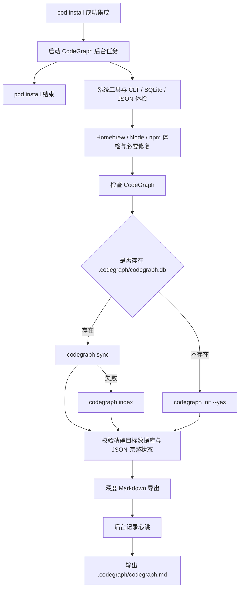

# `codegraph_init.command`


<!-- jobs-toc:start -->
<!-- jobs-toc:source {"v":2,"token":"[toc]"} -->
<details>
<summary>📚 目录（点击展开 / 收起）</summary>

- [🔥 前言](#jobs-toc-heading-1)
- [一、执行流程](#jobs-toc-heading-2)
- [二、运行方式](#jobs-toc-heading-3)
- [三、后台心跳](#jobs-toc-heading-4)
- [四、导出参数](#jobs-toc-heading-5)
- [五、日志文件](#jobs-toc-heading-6)
- [六、环境开关与恢复边界](#jobs-toc-heading-7)

</details>
<!-- jobs-toc:end -->

---

## <span id="jobs-toc-heading-1" data-jobs-toc="v2">🔥 <font id=前言>前言</font></span><!-- jobs-toc:heading-end -->

本目录中可独立运行的 `.command` 入口先显示内置自述：标题红色加粗，编号正文蓝色且不加粗；在终端按回车确认后才进入建图流程，按 `Ctrl+C` 取消。非彩色终端显示纯文本；独立建图时没有可交互输入则停止。`--check-only` 无需确认且不会安装、建图或导出。已明确设置 `CODEGRAPH_AUTO_INIT=1` 的自动流程保持无交互策略；已确认的初始化入口调用导出脚本时透传确认状态，不重复阻塞后台导出。

`codegraph_init.command` 由 `Podfile` 的 `post_integrate` 在工程集成完成后异步启动，完成 [**CodeGraph**](https://github.com/colbymchenry/codegraph) 初始化 / 同步，并调用相邻的 `../codegraph_export_md.command/codegraph_export_md.command` 导出深度 [**Markdown**](https://markdown.cn) / [**Mermaid**](https://mermaid.js.org) 项目关系图谱。

自动流程包含：

- `pod install` 进入 CodeGraph 阶段后只负责启动后台任务，不再等待索引和导出完成。
- 后台流程内会定时记录导出心跳和最近日志，方便排查长时间任务。
- 默认不再硬筛 `calls,extends,implements`，而是交给导出脚本根据数据库实际 `edge kind` 自动生成有内容的报告。
- 工具按“发现 → 实际执行体检 → 缺失 / 损坏时修复一次 → 复检”处理；健康组件直接复用，不主动升级。
- 全局工具链锁串行化体检与安装，工程锁覆盖索引及导出；重复调用不会并发改写同一工程。
- 成功必须同时满足精确工程数据库的 `nodes` 表、JSON 项目 / 输出路径、索引时间、完整状态及待处理计数校验。

| 已有行为 | 当前行为 |
| --- | --- |
| 命令存在即视为安装成功 | 系统工具、CLT、Homebrew、Node/npm、CodeGraph 和 SQLite / JSON 逐层实际执行检查；正常更新前还用隔离样例真实建图 |
| 缺工具跳过或直接 npm 全局安装 | 允许安装时通过 Brew 补齐 `node@24`，官方 npm 包安装至用户独立前缀；只读 / 离线时禁止安装 |
| 只检查数据库文件存在 | 确认目标自己的数据库与完整索引状态；拒绝地图及直属条目符号链接，防止访问其它项目 |

当前官方 CodeGraph 没有可用的 Homebrew formula；不会运行 `brew install codegraph` 或安装另一个同名产品。实际通道为 [**Homebrew**](https://brew.sh/) → [**Node.js**](https://nodejs.org) / [**npm**](https://docs.npmjs.com/) → 官方 `@colbymchenry/codegraph`，安装前输出来源、动作与目标，保留已有全局 CLI。

---

## <span id="jobs-toc-heading-2" data-jobs-toc="v2">一、执行流程 <a href="#前言" style="font-size:17px; color:green;"><b>🔼</b></a> <a href="#🔚" style="font-size:17px; color:green;"><b>🔽</b></a></span><!-- jobs-toc:heading-end -->



---

## <span id="jobs-toc-heading-3" data-jobs-toc="v2">二、运行方式 <a href="#前言" style="font-size:17px; color:green;"><b>🔼</b></a> <a href="#🔚" style="font-size:17px; color:green;"><b>🔽</b></a></span><!-- jobs-toc:heading-end -->

- 双击入口需要执行权限时，在本说明所在目录授权：

  ```shell
  chmod +x ./codegraph_init.command
  chmod +x ../codegraph_export_md.command/codegraph_export_md.command
  ```

- 独立运行（不依赖执行权限）：

  ```shell
  /bin/zsh ./codegraph_init.command
  ```

- 正常执行：

  ```shell
  cd ../..
  pod install
  ```

- `pod install` 只会输出后台 PID 和日志路径，不会等待 CodeGraph 完成。重复执行时，如果上一个后台任务仍在运行，不会再启动第二个。

- 只读体检（不安装、不建图、不导出）：

  ```shell
  /bin/zsh ./codegraph_init.command --check-only
  ```

- 查看后台进度：将占位路径替换为安装输出中的完整后台日志路径。

  ```shell
  tail -f "<安装输出中的完整后台日志路径>"
  ```

  后台日志名为 `codegraph_init.<工程摘要>.async.log`，位于系统临时目录；独立执行与体检细节见同位置的 `codegraph_init.<工程摘要>.log`。

`pod install` 在成功集成后启动体检、安装、索引和导出；后台失败写日志，不改变 [**CocoaPods**](https://cocoapods.org/) 的安装结果。`JOBS_SKIP_CODEGRAPH=1` 可跳过地图任务；仅安装前的 `--preflight` 阶段不会启动地图更新。

---

## <span id="jobs-toc-heading-4" data-jobs-toc="v2">三、后台心跳 <a href="#前言" style="font-size:17px; color:green;"><b>🔼</b></a> <a href="#🔚" style="font-size:17px; color:green;"><b>🔽</b></a></span><!-- jobs-toc:heading-end -->

CodeGraph 导出默认不设置超时，并每 `10s` 将心跳写入日志：

```text
ℹ Markdown 导出仍在运行：30s；PID=xxx
```

可配置：

| 变量 | 默认值 | 说明 |
| --- | --- | --- |
| `CODEGRAPH_EXPORT_HEARTBEAT_SECONDS` | `10` | 心跳间隔 |
| `CODEGRAPH_EXPORT_TIMEOUT_SECONDS` | `0` | 导出超时，`0` 表示不超时 |
| `CODEGRAPH_EXPORT_ASYNC` | `0` | 兼容旧参数；安装 hook 已异步，脚本内部等待导出以保留工程锁 |

---

## <span id="jobs-toc-heading-5" data-jobs-toc="v2">四、导出参数 <a href="#前言" style="font-size:17px; color:green;"><b>🔼</b></a> <a href="#🔚" style="font-size:17px; color:green;"><b>🔽</b></a></span><!-- jobs-toc:heading-end -->

| 变量 | 默认值 | 说明 |
| --- | --- | --- |
| `CODEGRAPH_MD_OUT_DIR` | `.codegraph/codegraph.md` | 输出目录 |
| `CODEGRAPH_MD_EDGE_KINDS` | `auto` | 自动根据数据库实际边类型导出 |
| `CODEGRAPH_MD_EDGE_SCAN_LIMIT` | `20000` | 扫描边数上限 |
| `CODEGRAPH_MD_EDGE_EXPORT_LIMIT` | `5000` | 明细导出边数上限 |
| `CODEGRAPH_MD_GRAPH_EDGE_LIMIT` | `25` | 单张符号图边数 |
| `CODEGRAPH_MD_GRAPH_DIRECTION` | `LR` | 图方向 |

- 更完整导出：

  ```shell
  CODEGRAPH_MD_EDGE_SCAN_LIMIT=100000 \
  CODEGRAPH_MD_EDGE_EXPORT_LIMIT=20000 \
  pod install
  ```

- 只更新数据库，不导出文档：

  ```shell
  CODEGRAPH_SKIP_EXPORT=1 pod install
  ```

---

## <span id="jobs-toc-heading-6" data-jobs-toc="v2">五、日志文件 <a href="#前言" style="font-size:17px; color:green;"><b>🔼</b></a> <a href="#🔚" style="font-size:17px; color:green;"><b>🔽</b></a></span><!-- jobs-toc:heading-end -->

| 日志 | 说明 |
| --- | --- |
| 系统临时目录中的 `codegraph_init.<工程摘要>.async.log` | `pod install` 启动的完整后台流程日志 |
| 系统临时目录中的 `codegraph_init.<工程摘要>.log` | 初始化 / 同步 / 调度与工具链体检日志 |
| 系统临时目录中的 `codegraph_export_md.log` | 导出脚本前台日志 |
| 系统临时目录中的 `codegraph_export_md.async.log` | 单独异步调用导出脚本时的日志 |

## <span id="jobs-toc-heading-7" data-jobs-toc="v2">六、环境开关与恢复边界 <a href="#前言" style="font-size:17px; color:green;"><b>🔼</b></a> <a href="#🔚" style="font-size:17px; color:green;"><b>🔽</b></a></span><!-- jobs-toc:heading-end -->

| 参数 / 环境变量 | 默认值与行为 |
| --- | --- |
| `--project-root 路径` / `JOBS_CODEGRAPH_PROJECT_ROOT` | 默认按脚本位置定位工程，不依赖终端当前目录 |
| `--check-only` | 禁止安装、索引、导出和工程锁写入，仅记录诊断日志 |
| `CODEGRAPH_ALLOW_INSTALL` | 默认 `1`；`0` 禁止安装或修复，后台 hook 明确传 `1` |
| `JOBS_POD_INSTALL_OFFLINE=1` | 覆盖允许安装开关，缺依赖立即停止本次地图任务 |
| `CODEGRAPH_AUTO_INIT=1` | 已授权 Podfile 自动入口无交互，仍打印内置自述 |
| `JOBS_SKIP_CODEGRAPH=1` | 跳过地图任务 |
| `CODEGRAPH_SKIP_EXPORT=1` | 只更新数据库 |

- Homebrew 缺失时需在交互终端选择安装位置：精确 `YES` 选择系统目录，其它输入或回车选择用户目录；后台无法选择时停止并提示在终端完成安装。路径失败不会自动切换，不预先收集管理员密码。
- 不自动运行 `brew update`、全局 `upgrade` 或 `cleanup`；`brew doctor` 全部诊断保留。无关 cask、tap 或 keg 警告不等于当前依赖不可执行；必需层的实际命令失败仍停止下游。
- Node/npm 缺失或损坏时 Brew 安装 / 重装一次 `node@24`，并立即复检；CodeGraph 安装前测试官方 Registry，保留平台可选包，安装后验证 CLI 与隔离建图。
- 业务初始化显式使用 `CODEGRAPH_NO_WATCH=0`，避开发布版 1.6.2 在 `NO_WATCH=1 + init --yes` 下自动写 Git hooks 的分支；临时体检样例不属于 Git 仓库，使用 `NO_WATCH=1` 防止遗留样例守护进程。
- 系统 SQLite 对没有 WAL 附属文件的数据库只读打开失败时，仅在不存在 `codegraph.db-wal` 的条件下回退到只读 immutable URI 检查 `nodes` 表；完整状态仍由 CodeGraph JSON 验收，不忽略活跃 WAL。
- PATH 与环境仅作用当前脚本和子进程，不写 Shell 配置或代理，不调用 `codegraph install`。工具链体检和安装日志追加保存；本工程锁在正常结束或受控中断时释放，无法确认的锁保留并报告，不能只凭旧 PID 跳过。
- 索引完整性失败停止导出；Markdown 失败 / 超时单独报告，已完成数据库保留。脚本返回失败，但异步挂载不会改写 CocoaPods 的退出状态。

<a id="🔚" href="#前言" style="font-size:17px; color:green; font-weight:bold;">我是有底线的➤点我回到首页</a>
