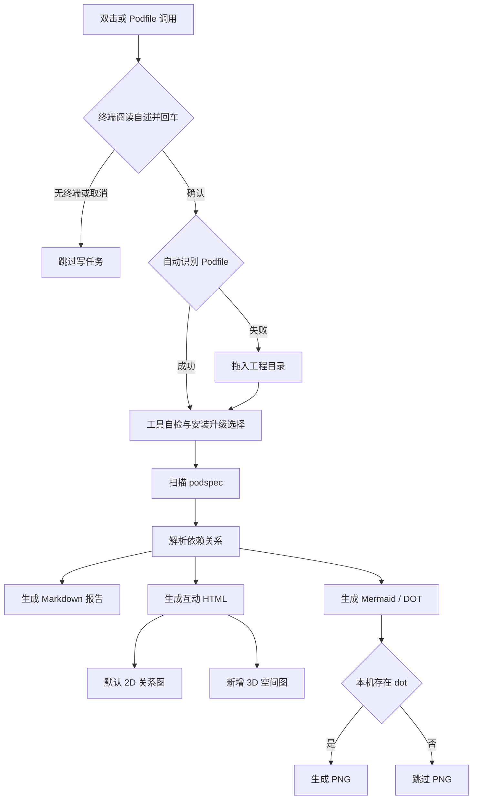

# `【MacOS】🔍查询Xcode工程依赖关系.command`


<!-- jobs-toc:start -->
<!-- jobs-toc:source {"v":2,"token":"[toc]"} -->
<details>
<summary>📚 目录（点击展开 / 收起）</summary>

- [🔥 前言](#jobs-toc-heading-1)
- [一、适用场景](#jobs-toc-heading-2)
- [二、运行方式](#jobs-toc-heading-3)
  - [2.1、双击运行](#jobs-toc-heading-4)
  - [2.2、终端运行](#jobs-toc-heading-5)
  - [2.3、Podfile 自动钩子](#jobs-toc-heading-6)
- [三、产物说明](#jobs-toc-heading-7)
- [四、3D 互动说明](#jobs-toc-heading-8)
- [五、流程图](#jobs-toc-heading-9)
- [六、执行前检查](#jobs-toc-heading-10)
- [七、风险说明](#jobs-toc-heading-11)
- [八、日志文件](#jobs-toc-heading-12)
- [九、验证记录](#jobs-toc-heading-13)

</details>
<!-- jobs-toc:end -->

---

## <span id="jobs-toc-heading-1" data-jobs-toc="v2">🔥 <font id=前言>前言</font></span><!-- jobs-toc:heading-end -->

> 这个脚本用于扫描 [**Xcode**](https://developer.apple.com/xcode) / [**CocoaPods**](https://cocoapods.org/) 工程里的 `*.podspec`，输出依赖分析报告、[**Mermaid**](https://mermaid.js.org) 图源码、[**Graphviz**](https://graphviz.org/) 图源码和互动 HTML 图。

同一个 HTML 产物提供稳定扫读的 `2D 关系图` 与可旋转的 `3D 空间图`，按需切换视图。

## <span id="jobs-toc-heading-2" data-jobs-toc="v2">一、适用场景 <a href="#前言" style="font-size:17px; color:green;"><b>🔼</b></a> <a href="#🔚" style="font-size:17px; color:green;"><b>🔽</b></a></span><!-- jobs-toc:heading-end -->

- 适合分析一个包含 `Podfile` 的 [**CocoaPods**](https://cocoapods.org/) 工程。
- 适合查看多个 `*.podspec` 之间的上下游依赖。
- 适合快速定位：
  - 哪些 Pod 没有下游依赖。
  - 哪些 Pod 被大量引用。
  - 哪些 Pod 存在仓库内循环依赖。
  - 哪些依赖来自外部 Pod。
- 适合做给人看的代码地图：原 2D 图用于稳定扫读，新 3D 图用于空间化理解依赖结构。

## <span id="jobs-toc-heading-3" data-jobs-toc="v2">二、运行方式 <a href="#前言" style="font-size:17px; color:green;"><b>🔼</b></a> <a href="#🔚" style="font-size:17px; color:green;"><b>🔽</b></a></span><!-- jobs-toc:heading-end -->

### <span id="jobs-toc-heading-4" data-jobs-toc="v2">2.1、双击运行 <a href="#前言" style="font-size:17px; color:green;"><b>🔼</b></a> <a href="#🔚" style="font-size:17px; color:green;"><b>🔽</b></a></span><!-- jobs-toc:heading-end -->

- 推荐把整个文件夹放到目标工程根目录，或放到目标工程的下一层目录。
- 双击运行：

  ```text
  【MacOS】🔍查询Xcode工程依赖关系.command
  ```

- 脚本会优先检测：
  - 脚本所在目录是否存在 `Podfile`。
  - 脚本所在目录的上一层是否存在 `Podfile`。
- 如果自动识别失败，会要求你拖入一个包含 `Podfile` 的工程目录。

### <span id="jobs-toc-heading-5" data-jobs-toc="v2">2.2、终端运行 <a href="#前言" style="font-size:17px; color:green;"><b>🔼</b></a> <a href="#🔚" style="font-size:17px; color:green;"><b>🔽</b></a></span><!-- jobs-toc:heading-end -->

- 也可以在终端里执行：

  ```shell
  zsh './【MacOS】🔍查询Xcode工程依赖关系.command'
  ```

### <span id="jobs-toc-heading-6" data-jobs-toc="v2">2.3、Podfile 自动钩子 <a href="#前言" style="font-size:17px; color:green;"><b>🔼</b></a> <a href="#🔚" style="font-size:17px; color:green;"><b>🔽</b></a></span><!-- jobs-toc:heading-end -->

- 自动钩子通过 `JOBS_PROJECT_ROOT` 直接传入工程根目录，省去重复拖入路径；仍先显示自述并等待回车，自动定位不等于授权。
- 生成报告后询问是否打开产物：直接回车保留文件但不打开，输入任意字符后才打开 HTML、Markdown 和已有 PNG。
- 默认保留 Homebrew 自检 / 更新、Graphviz 安装 / 升级选择；普通安装和更新均为直接回车跳过、输入任意字符后回车执行。
- 只有显式 `JOBS_POD_INSTALL_OFFLINE=1` 时才只复用本机已有的 `dot`，不安装或升级 Homebrew / Graphviz。
- `JOBS_POD_INSTALL_INTERACTION=check-only` 只检查工程路径，不生成报告或安装工具；`skip` 跳过。默认交互模式在无 TTY 或输入结束时停止写任务。

## <span id="jobs-toc-heading-7" data-jobs-toc="v2">三、产物说明 <a href="#前言" style="font-size:17px; color:green;"><b>🔼</b></a> <a href="#🔚" style="font-size:17px; color:green;"><b>🔽</b></a></span><!-- jobs-toc:heading-end -->

- 脚本会在工程目录下生成固定输出目录：

  ```text
  PodspecDependencyReport/
  ```

- 主要文件如下：

  | 文件 | 说明 |
  | --- | --- |
  | `PodspecDependencies_interactive.html` | 互动 HTML 图，默认保留原 2D 视图，并新增可拖动旋转的 3D 视图。 |
  | `PodspecDependencies.md` | 依赖分析 Markdown 报告。 |
  | `PodspecDependencies_all.mmd` | 全部依赖 [**Mermaid**](https://mermaid.js.org) 图源码。 |
  | `PodspecDependencies_internal.mmd` | 仓库内 Pod 相互依赖 [**Mermaid**](https://mermaid.js.org) 图源码。 |
  | `PodspecDependencies_all.dot` | 全部依赖 [**Graphviz**](https://graphviz.org/) DOT 源码。 |
  | `PodspecDependencies_internal.dot` | 仓库内 Pod 相互依赖 [**Graphviz**](https://graphviz.org/) DOT 源码。 |
  | `PodspecDependencies_all.png` | 如果本机存在 `dot` 命令，则额外生成全部依赖 PNG。 |
  | `PodspecDependencies_internal.png` | 如果本机存在 `dot` 命令，则额外生成仓库内依赖 PNG。 |

## <span id="jobs-toc-heading-8" data-jobs-toc="v2">四、3D 互动说明 <a href="#前言" style="font-size:17px; color:green;"><b>🔼</b></a> <a href="#🔚" style="font-size:17px; color:green;"><b>🔽</b></a></span><!-- jobs-toc:heading-end -->

- 打开 `PodspecDependencies_interactive.html` 后，顶部会看到两个视图按钮：
  - `2D 关系图`
  - `3D 空间图`
- 默认仍然是 `2D 关系图`，不会破坏原来的使用习惯。
- 点击 `3D 空间图` 后：
  - 鼠标拖动：旋转 3D 依赖空间。
  - 鼠标滚轮：缩放。
  - 点击节点：聚焦该 Pod，并显示上下游依赖。
  - 顶部搜索框、依赖模式、邻居层级仍然生效。

## <span id="jobs-toc-heading-9" data-jobs-toc="v2">五、流程图 <a href="#前言" style="font-size:17px; color:green;"><b>🔼</b></a> <a href="#🔚" style="font-size:17px; color:green;"><b>🔽</b></a></span><!-- jobs-toc:heading-end -->



## <span id="jobs-toc-heading-10" data-jobs-toc="v2">六、执行前检查 <a href="#前言" style="font-size:17px; color:green;"><b>🔼</b></a> <a href="#🔚" style="font-size:17px; color:green;"><b>🔽</b></a></span><!-- jobs-toc:heading-end -->

- 工程目录必须直接包含 `Podfile`。
- 工程内需要存在 `*.podspec` 文件，否则报告会提示未找到。
- 脚本会使用系统自带 [**Ruby**](https://www.ruby-lang.org/) 解析依赖。
- 如果需要 PNG 图，脚本会检查 [**Homebrew**](https://brew.sh/) 和 `graphviz`。
- 已安装 [**Homebrew**](https://brew.sh/) 时，脚本不会默认升级，只有你输入任意字符后回车才会执行更新和自检。
- Homebrew 缺失时先询问是否安装；同意后精确输入 `YES` 选择系统标准目录，其它输入选择当前用户目录。官方安装器自行处理实际授权；仅在当前脚本激活环境，不写 shell profile。

## <span id="jobs-toc-heading-11" data-jobs-toc="v2">七、风险说明 <a href="#前言" style="font-size:17px; color:green;"><b>🔼</b></a> <a href="#🔚" style="font-size:17px; color:green;"><b>🔽</b></a></span><!-- jobs-toc:heading-end -->

- 脚本会覆盖固定目录中的同名生成报告，并保留其它用户文件；目录为符号链接或非目录、或者同名生成产物为符号链接时拒绝写入：

  ```text
  PodspecDependencyReport/
  ```

- 脚本不会主动修改你的 `Podfile`、`*.podspec` 或业务源码。
- [**Homebrew**](https://brew.sh/) / `graphviz` 相关操作会在终端中提示，不会静默执行升级。
- 显式离线模式不会安装或升级 [**Homebrew**](https://brew.sh/) / `graphviz`，缺少 `dot` 时直接跳过 PNG；Podfile 默认不强制进入离线模式。
- 如果 `dot` 不存在，只影响 PNG 生成；`Markdown` 报告和互动 HTML 仍会生成。
- 已有 `dot` 但转换失败，或报告生成器失败时，会明确告警并返回辅助任务失败状态；不能把已开始生成当作全部产物成功。

## <span id="jobs-toc-heading-12" data-jobs-toc="v2">八、日志文件 <a href="#前言" style="font-size:17px; color:green;"><b>🔼</b></a> <a href="#🔚" style="font-size:17px; color:green;"><b>🔽</b></a></span><!-- jobs-toc:heading-end -->

- 运行日志位置：

  ```text
  $TMPDIR/【MacOS】🔍查询Xcode工程依赖关系.log
  ```

## <span id="jobs-toc-heading-13" data-jobs-toc="v2">九、验证记录 <a href="#前言" style="font-size:17px; color:green;"><b>🔼</b></a> <a href="#🔚" style="font-size:17px; color:green;"><b>🔽</b></a></span><!-- jobs-toc:heading-end -->

- 当前打包环境未安装 `zsh`，所以没有执行下面这条 MacOS 本机静态检查：

  ```shell
  zsh -n '【MacOS】🔍查询Xcode工程依赖关系.command'
  ```

- 已抽取脚本内置 [**Ruby**](https://www.ruby-lang.org/) 生成器并执行语法检查：

  ```shell
  ruby -c .generate_podspec_dependency_report.rb
  ```

- 已使用临时示例 `Podfile` / `*.podspec` 跑通生成器，确认 `PodspecDependencies_interactive.html` 中存在 `2D 关系图`、`3D 空间图` 和 `canvas3d`。
- 当前环境没有实际打开 [**Xcode**](https://developer.apple.com/xcode) 工程执行脚本，因此未做真实工程扫描。
- 3D 效果实现方式为原生 `canvas` + JavaScript 投影渲染，不依赖外部模型文件，也不依赖远程 JS CDN。

<a id="🔚" href="#前言" style="font-size:17px; color:green; font-weight:bold;">我是有底线的➤点我回到首页</a>
